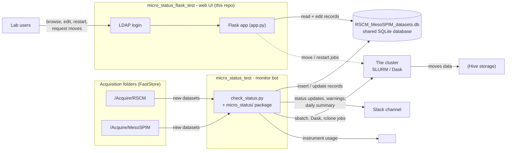

# micro_status_flask_test — dataset web interface

Authenticated Flask web app for monitoring acquisition and processing of **RSCM** and
**MesoSPIM** datasets. It works with the SQLite database populated and maintained by the
RSCM/MesoSPIM slack bot ([`micro_status_test`](../micro_status_test/)) — the same file,
viewed and edited through a browser.

This is one half of a two-part system; the monitoring bot is the other half — see
[Related project](#related-project-micro_status_test).

> **Paths and hosts in this document** are deployment-specific placeholders:
> `<FS_ROOT>` = FastStore data root · `<HIVE_ROOT>` = Hive data root ·
> `<LOGIN_NODE>` = lab login node · `<SCHEDULER_HOST>` = online scheduler host ·
> `<USER>` = lab account name.
> Actual values live in `micro_status_flask/settings.py` (and the app config) on the server.

## How the two projects fit together



The **shared SQLite database is the contract between the two projects**:

- the bot inserts datasets and continuously updates statuses, progress counters and flags;
- this web app lets authenticated lab members browse and edit the same records;
- edits made here (e.g. `paused`, `keep_composites`, restarts, move requests) are picked
  up by the bot on its next scan.

## Features

| Route | What it does |
|---|---|
| `/` | MesoSPIM dashboard (default page): dataset table filtered by modality, time (`week` / `month` / `year`) and PI. Non-admin users automatically see only their own PI's datasets; the admin account (role ID defined in code) can filter by any PI. |
| `/rscm` | RSCM dashboard: same table and filters, restricted to RSCM datasets. |
| `/datasets/<id>/edit` | Edit a curated subset of fields in a two-column layout (RSCM-specific fields appear only for RSCM datasets; unlisted fields and the created timestamp are left untouched). After saving, returns to the modality page for the dataset. Deletion is not supported. |
| `/datasets/new` | Create a new record (sets the `created` timestamp). |
| `/datasets/<id>/restart` | Restart processing. MesoSPIM: submits `mesospim_utils` (`automated.py`) as a SLURM job (zarr input, `ims` final file). RSCM: writes a stitch-queue file under `RSCM_FOLDER_STITCHING/queueStitch`. |
| `/datasets/<id>/move` | Move a dataset to `<HIVE_ROOT>`: generates an sbatch script (`rclone copy` → `rclone check` → source to trash, with complete/error markers) under `<FS_ROOT>/tmp/move_jobs`, submits it, sets `moving=1`. |
| `/datasets/<id>/mosaic` | Align MesoSPIM OME-Zarr 0.4 tiles on a zoomable z-plane and save the positions in `mosaic.json` beside the dataset. |
| `/datasets/<id>/virtual_stitched` | **View virtually stitched tiles**: prepares `mosaic.json` beside the dataset when missing (created from the stage positions; a valid existing manifest is reused) and opens the virtually stitched mosaic in Neuroglancer in a new tab (see below). |
| `/datasets/<id>/export_imaris` | Submit a MesoSPIM virtual-mosaic Imaris export to SLURM's `ai` partition (32 CPUs, 256 GB RAM). |
| `/login`, `/logout`, `/profile` | LDAP authentication (see below). |

## Authentication

- LDAP via `ldap3` (NTLM) against the institute's Windows domain
  (`ldap://<domain_server>:<domain_port>`).
- `flask_login` session management; the login route is rate-limited (`flask_limiter`).
- The logged-in username is matched against the `pi` table: lab members see that lab's
  datasets; the admin account (role ID defined in code) sees and can filter everything.
- A `bypass_auth` option exists in the auth config for testing only.

## Repository layout

| Path | Purpose |
|---|---|
| `micro_status_flask/app.py` | Flask app, routes, DB config, move/restart job generation |
| `micro_status_flask/server.py` | Single-port ASGI entry point mounting Flask and the virtual-Zarr service |
| `micro_status_flask/auth.py` | Login manager, LDAP auth, login/logout/profile routes, rate limiting |
| `micro_status_flask/models.py` | SQLAlchemy models (`Dataset`, `PI`, `CLNumber`) mapping the existing schema |
| `micro_status_flask/forms.py` | WTForms definitions (`DatasetForm`) |
| `micro_status_flask/mosaic.py` | Discover stage-positioned OME-Zarr tiles, render selected slices and save manifests |
| `micro_status_flask/static/mosaic.js` | Tile alignment controls and viewport-aware image loading |
| `micro_status_flask/settings.py` | Paths shared with the bot (DB location, storage folders, move-jobs dir) |
| `micro_status_flask/templates/` | Jinja templates |
| `requirements-combined.txt` | Python 3.12 dependencies for both web apps and their tests |
| `micro_status_flask/data.db` | Stale local artifact — the real DB is at `<FS_ROOT>/RSCM_MesoSPIM_datasets.db` |

## Database

- The app points at the same shared database as the bot:
  `sqlite:////<FS_ROOT>/RSCM_MesoSPIM_datasets.db` (`SQLALCHEMY_DATABASE_URI`
  in `app.py`); some helpers also use `settings.DB_LOCATION` directly via `sqlite3`.
- The SQLAlchemy models map onto the schema created and maintained by the bot — **do not
  rename tables or columns**, and keep form fields aligned with model attributes so
  `form.populate_obj(...)` keeps working.
- Status vocabularies written by the bot: `imaging_status` = `in_progress` / `paused` /
  `finished`; `processing_status` = `not_started` / `started` / `stitched` /
  `moved_to_hive` / `denoised` / `built_ims` / `finished`.

## Setup & run (login node)

```bash
ssh <USER>@<LOGIN_NODE>
cd <path-to-micro_status_flask_test>  # repository root
conda create -n microstatus-neuroglancer -y python=3.12 pip
conda activate microstatus-neuroglancer
python -m pip install -r requirements-combined.txt
python -m pip install -e ../../mesospim_virtual_zarr_source/mesospim_virtual_zarr \
                      -e ../../peace/flask_file_browser_test
cd micro_status_flask
python app.py
```

The dashboard is at **http://<LOGIN_NODE>:1414**, with the virtual-Zarr
service and bundled Neuroglancer client on the same port under
`/virtual-zarr/`. Only one process needs to be started. Keep the external
`flask_file_browser/settings.ini` auth configuration available in the editable
`flask_file_browser` source tree; it supplies the Flask session and viewer-token
secret. The existing environments are not modified.

Notes:

- Start from **inside** `micro_status_flask/`: `app.py` imports sibling modules
  (`settings`, `auth`, `models`, `forms`) as top-level modules.
- `requirements-combined.txt` covers the PyPI dependencies; the two local
  editable installs above provide the mosaic engine and the existing auth config.
- The separate `requirements-viewer.txt` only covers the older tile-alignment
  viewer, not Neuroglancer or the combined server.
- `python3 -m compileall micro_status_flask` is the safe syntax check.

## MesoSPIM OME-Zarr tile alignment

On a MesoSPIM dataset's edit page, select **Align OME-Zarr tiles**. The viewer
finds acquisitions in the dataset directory (or one directory below), including
either its FastStore or Hive location. It requires numbered, rectangular,
column-major `Tile0`, `Tile1`, ... OME-Zarr 0.4 groups with stage translations in
their multiscales metadata. Select an acquisition if more than one is present.
The first channel is shown; the resulting geometry applies to all channels.

The viewer starts at the middle z-plane with low-resolution images. Scroll to
zoom into the tiles in view and use the z and common contrast sliders. Select
**Pan** to drag the image or **Move tiles** to drag a tile into coarse alignment;
in Move mode, dragging the background still pans. In overlapping areas, the
topmost tile is selected. Use each tile's arrow buttons to move it one
highest-resolution pixel at a time (Shift+arrow button moves ten). Click
**Save positions** to create or update
`mosaic.json` in the dataset directory. Existing positions for the selected
acquisition are loaded when reopening it. A dataset has a single `mosaic.json`,
so saving another acquisition replaces that manifest. Its `tiles` or `channels`,
`rows`, `cols` and `positions_zyx` keys are compatible with
`mesospim_virtual_zarr`'s manifest loader; tile paths are relative to the
manifest. The viewer reads source tiles without modifying them.

The image routes serve on-demand PNG patches and cache a few decoded planes.
The largest level-0 chunks in the supplied example expand to roughly 550 MiB;
image reads are serialized to keep concurrent zoom requests from multiplying
that memory usage.

## Virtual stitched tiles in Neuroglancer

On a MesoSPIM dataset's edit page, select **View virtually stitched tiles**
(shown whenever OME-Zarr tiles are discovered). The route creates
`mosaic.json` beside the dataset from the stage positions when it is missing
(a valid existing manifest, including manual positions and per-channel colors,
is reused, never silently replaced) and opens a new tab with the virtually
stitched mosaic in Neuroglancer: a zoomed-out single-panel (XY) view showing
the whole dataset at a coarse pyramid level, one image layer per channel, an
initial position on the middle z/y/x plane of the volume and per-channel
display windows.

The new tab is served by [`mesospim_virtual_zarr`](../../mesospim_virtual_zarr_source/mesospim_virtual_zarr/)
inside the same Python 3.12 process as Flask. `server.py` mounts its FastAPI
app at `/virtual-zarr` and mounts Flask at `/`; Uvicorn serves both on port 1414.

- `VIRTUAL_ZARR_SERVICE_PATH` in `micro_status_flask/settings.py` is the
  same-origin mount path, not an address on another port.
- The viewer and chunk requests carry an expiring per-dataset token signed with
  this app's auth-configured secret key; the service uses that same key to verify
  tokens before reading `mosaic.json`, `gain.json` or any tile, and refuses
  requests for other datasets. A change of key invalidates existing logins and
  viewer links.
- The service serves the virtual OME-Zarr 0.5 chunks and the local Neuroglancer
  client (bundled with the `neuroglancer` package) from one origin, so no CORS
  or reverse proxy is needed. The bundled client is served under
  `/virtual-zarr/v/viewer/` because the python-integration build requires a
  `/v/.../` URL path segment to initialize; a cosmetic "Connecting to Python
  server" status at the bottom of the viewer is safe to ignore.
- Output chunks are composed on demand from the source tiles; first visits to a
  region are slower than a materialized stitched Zarr. Datasets stay loaded in a
  bounded RAM cache until the manifest or `gain.json` changes. Both Flask tile
  alignment and virtual chunk compositing now share process memory; the service
  still limits concurrent chunk work and runs with one Uvicorn worker.

## Export to Imaris

On a MesoSPIM edit page with OME-Zarr tiles, **Export to Imaris** uses the same
`mosaic.json` as the virtual-stitched viewer (creating it from stage positions
if needed). It submits `virtual_mesospim.export_ims` using the Python interpreter
in `IMARIS_EXPORT_PYTHON` and requests the `ai` partition, 32 CPUs and 256 GB RAM.
The completed file is written to `<dataset>/virtual_ims/<acquisition>.ims`;
the exporter refuses to overwrite it. SLURM scripts and logs are under
`IMARIS_EXPORT_JOBS_DIR`; the page reports the job ID, output and log location.
The existing `imaris_file_path` database field is not changed. Only one job per
dataset can be queued or running at a time for the submitting account.

## External auth config

`setup_auth()` in `auth.py` reads an INI-style config file via
`flask_file_browser.routes.settings` (lives outside this repo). Expected sections/keys:

| Section | Keys |
|---|---|
| `[auth]` | `secret_key`, `login_limit`, `bypass_auth`, `domain_server`, `domain_port`, `domain_name` |
| `[app]` | `name` |
| `[GA4]` | `gtag` |

## Caveats & warnings

- `app.py` starts one Uvicorn worker on `0.0.0.0:1414` without a debug reloader.
- Mutating routes (edit, create, restart, move) are `@login_required`; both
  dashboards (`/`, `/rscm`) are as well.
- Edits write to the **live** database — the bot picks up changes on its next scan.
- `data.db` in the repo is a local artifact; the real database is external.

## Related project: micro_status_test

[`micro_status_test`](../micro_status_test/) is the monitoring bot that populates this
app's database: it discovers datasets in the acquisition folders, tracks imaging and
processing progress, posts Slack updates and warnings, submits cluster work and moves
data to `<HIVE_ROOT>`. Without the bot this app just shows an empty (or stale) database — see
the diagram at the top.
